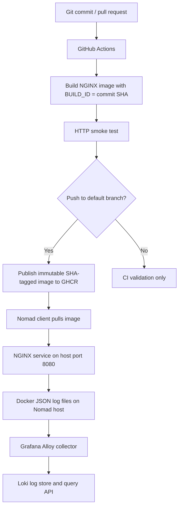

# DevOps Intern Final Assessment — NGINX + Docker + GitHub Actions + Nomad + Loki

A reproducible DevOps assessment project that packages a static NGINX page, injects a build ID during image construction, builds and smoke-tests the image in GitHub Actions, publishes a commit-tagged image to GitHub Container Registry (GHCR), deploys it with HashiCorp Nomad, and aggregates Docker container logs using Grafana Alloy and Loki.

> **Validation honesty:** static checks and a native NGINX serving test can be run without Docker. A real image build, GHCR publish, Nomad allocation, and Loki ingestion must be run in the target environment before claiming end-to-end success.

## Architecture



## Project files

```text
devops-intern-assessment/
├── .github/workflows/ci.yml    # CI, smoke test, Nomad syntax validation, GHCR publish
├── .dockerignore               # Files excluded from Docker build context
├── .gitignore                  # Excludes IDE files, local secrets, generated files
├── Dockerfile                  # NGINX image + build-time BUILD_ID injection
├── index.html                  # Assessment webpage
├── nomad/nginx.nomad.hcl       # Nomad service job (no Kubernetes)
├── logging/
│   ├── docker-compose.yml      # Local Loki + Alloy services
│   ├── config.alloy            # Docker JSON log collection and forwarding
│   └── loki-config.yaml        # Single-node local Loki config
├── scripts/
│   ├── build.sh                # Build local image
│   ├── test.sh                 # Run image and verify HTTP content
│   ├── deploy.sh               # Validate, plan and submit Nomad job
│   └── validate-static.py      # Offline project consistency checks
├── README.md
├── GIT-UPLOAD-GUIDE.md       # Git commands and GitHub push instructions
├── ASSESSMENT-MAPPING.md     # Requirement-to-file verification matrix
└── VALIDATION-REPORT.md
```

## Requirements

- Git and Bash.
- Docker Engine + Docker CLI for image build and smoke tests.
- `curl` for HTTP tests.
- Python 3 for offline static validation (PyYAML is optional but recommended).
- GitHub repository with Actions enabled for CI and GHCR publishing.
- A reachable Nomad cluster with a healthy client using the Docker driver. The sample job targets datacenter `dc1` and uses host port `8080`.
- For log aggregation, Docker Compose v2 on the same Linux host as the Nomad Docker client, with readable Docker JSON log files at `/var/lib/docker/containers/`.

The local Loki configuration is for assessment/demo use, not high availability. Do not expose the Nomad API or Loki API publicly.

## 1. Clone the repository

After creating your own empty GitHub repository and uploading these files:

```bash
git clone https://github.com/YOUR_GITHUB_USERNAME/YOUR_REPOSITORY.git
cd YOUR_REPOSITORY
git status --short
```

Replace the URL with your actual repository URL. The repository must not contain `.idea/`, editor metadata, credentials, or local `.env` files.

## 2. Run offline/static validation

```bash
python3 scripts/validate-static.py
bash -n scripts/build.sh scripts/test.sh scripts/deploy.sh
```

These checks do not need Docker or Nomad. They do not prove the image, job, or logging stack works at runtime.

## 3. Build the Docker image

The build script uses `BUILD_ID` if supplied, otherwise a short Git SHA when available, or a timestamp-based local ID when the directory has no commit yet.

```bash
./scripts/build.sh
```

Choose a specific ID for a repeatable local test:

```bash
BUILD_ID=local-001 IMAGE_NAME=devops-nginx ./scripts/build.sh
IMAGE_NAME=devops-nginx:local-001 EXPECTED_BUILD_ID=local-001 ./scripts/test.sh
```

The test starts a temporary container on `127.0.0.1:18080`, verifies the response and page content, and removes the container afterward. Override `HOST_PORT` if port `18080` is occupied.

Manual run:

```bash
docker run --rm --name devops-nginx-local -p 8080:80 devops-nginx:local-001
# In another terminal:
curl -fsS http://127.0.0.1:8080/
```

Stop a foreground container with `Ctrl+C`. If run detached, stop it with `docker stop devops-nginx-local`.

## 4. GitHub Actions and GHCR

Workflow: `.github/workflows/ci.yml`.

- Pushes and pull requests build the image with `BUILD_ID` equal to the full Git commit SHA.
- CI starts the container and checks HTTP response, name, assessment date, and build ID.
- CI validates the Nomad job syntax using the pinned Nomad CLI version in the workflow.
- Only a push to the repository's default branch publishes to GHCR, tagged `sha-<full-commit-sha>`.
- Pull requests do not publish images or require registry credentials.
- CI does not automatically deploy to Nomad; deployment is a deliberate operator action.

After the first successful publish, open the package in GitHub. For the simple pull command below, set the GHCR package visibility to public. For private packages, configure registry authentication securely on the Nomad client; never commit tokens.

## 5. Deploy to Nomad

Confirm the CLI is connected to the intended cluster and a client is healthy:

```bash
nomad status
nomad node status
```

Copy the exact image tag from the successful workflow and use the lowercase GHCR path:

```bash
export IMAGE="ghcr.io/YOUR_GITHUB_USERNAME/YOUR_REPOSITORY:sha-FULL_COMMIT_SHA"
nomad job validate -var "image=${IMAGE}" nomad/nginx.nomad.hcl
nomad job plan -var "image=${IMAGE}" nomad/nginx.nomad.hcl
nomad job run -var "image=${IMAGE}" nomad/nginx.nomad.hcl
nomad job status nginx-web
```

The job targets datacenter `dc1`, maps host port `8080` to container port `80`, and configures an HTTP health check. Ensure port `8080` is free on the chosen client and reachable from your test machine. If your Nomad cluster uses another datacenter, change `datacenters` in the job file and commit that change.

Verify deployment:

```bash
curl -i http://NOMAD_CLIENT_ADDRESS:8080/
nomad job status nginx-web
nomad alloc status ALLOCATION_ID
nomad alloc logs ALLOCATION_ID nginx
nomad alloc logs -stderr ALLOCATION_ID nginx
```

Replace `NOMAD_CLIENT_ADDRESS` and `ALLOCATION_ID` with values from your cluster. A successful `nomad job run` means the job was submitted; verify allocation health and the HTTP endpoint before calling it deployed.

### Deploy a local image (only if built on the Nomad client)

```bash
nomad job validate -var 'image=devops-nginx:local-001' -var 'force_pull=false' nomad/nginx.nomad.hcl
nomad job run -var 'image=devops-nginx:local-001' -var 'force_pull=false' nomad/nginx.nomad.hcl
```

The image must exist in the Docker daemon used by the Nomad client. An image on a laptop or GitHub-hosted runner is not automatically present on the Nomad host.

### Update, rollback, and cleanup

Update by submitting a new immutable image tag with `nomad job run`. The job uses an update strategy with automatic revert enabled; inspect deployment history and status before rollback.

```bash
nomad deployment list
nomad deployment status DEPLOYMENT_ID
nomad job history nginx-web
nomad job revert nginx-web JOB_VERSION
nomad job stop nginx-web
```

## 6. Log aggregation with Loki + Alloy

Run this on the same Linux Docker host as the Nomad Docker client so Alloy can read the Docker JSON logs for the deployed application:

```bash
cd logging
docker compose config
docker compose up -d
docker compose ps
```

NGINX's official image writes access/error logs to stdout/stderr; Docker's default `json-file` logging driver stores those streams in JSON log files. Alloy reads those files read-only, parses Docker's JSON envelope, and forwards records to Loki.

Generate a request to the deployed endpoint:

```bash
curl -i http://NOMAD_CLIENT_ADDRESS:8080/
```

Check Loki readiness:

```bash
curl -fsS http://127.0.0.1:3100/ready
```

Query logs:

```bash
curl -G -sS 'http://127.0.0.1:3100/loki/api/v1/query_range'   --data-urlencode 'query={job="docker"}'   --data-urlencode 'limit=50'   --data-urlencode 'direction=BACKWARD'
```

Confirm that the response contains the request path or a matching NGINX access-log entry. If no records appear, inspect Alloy's local UI at `http://127.0.0.1:12345`, its container logs, Loki readiness, Docker logging driver, and file permissions on `/var/lib/docker/containers`.

Stop the stack:

```bash
docker compose down
```

To also delete stored log data, run `docker compose down -v`. This permanently removes the named volumes.

## Requirement mapping

| Assessment requirement | File/evidence |
|---|---|
| Name, assessment date, build identifier | `index.html`, `Dockerfile` |
| Docker image build | `Dockerfile`, `scripts/build.sh` |
| Ignore IDE metadata and secrets | `.gitignore`, `.dockerignore` |
| Automated CI build and smoke test | `.github/workflows/ci.yml`, `scripts/test.sh` |
| SHA-tagged image publishing | `.github/workflows/ci.yml` (GHCR) |
| Replace Kubernetes manifests with Nomad | `nomad/nginx.nomad.hcl` |
| Health check and rollout policy | Nomad service check, `restart`, and `update` blocks |
| Log aggregation | `logging/docker-compose.yml`, `logging/config.alloy`, `logging/loki-config.yaml` |
| Reproducible instructions | This README |

## Evidence to capture

1. GitHub repository and `.gitignore`.
2. Successful Docker build and smoke test.
3. Website showing candidate, date, and actual build ID.
4. Successful GitHub Actions workflow.
5. GHCR image tagged `sha-...`.
6. Healthy Nomad job/allocation.
7. HTTP response from the Nomad-hosted application.
8. `nomad alloc logs` output.
9. Loki query result containing a real NGINX request.

## Troubleshooting

- **Docker unavailable:** start Docker Engine and check `docker info`.
- **Smoke test fails:** check `docker ps`, container logs, image tag, and port conflicts.
- **GHCR push denied:** verify Actions has `packages: write` and repository/package permissions.
- **Image pull fails in Nomad:** verify the exact lowercase image path/tag, client network access, and package visibility/credentials.
- **Nomad allocation pending:** inspect job/allocation status, datacenter, client eligibility, resource capacity, and port `8080`.
- **Health check fails:** inspect allocation logs and port mapping; verify the HTTP endpoint from the client.
- **No Loki logs:** check Alloy logs/UI, Docker JSON log path/permissions, logging driver, Loki readiness, and that Alloy runs on the same Docker host.

## Security and limitations

- Never commit tokens, passwords, private keys, or `.env` files.
- Keep the Nomad API private and protected by your cluster's access controls.
- Loki auth is disabled in this local assessment setup and its host port is bound to loopback; do not expose it to the internet.
- Alloy can read host container logs. Run it only on a trusted host and mount the Docker log directory read-only.
- Loki uses local filesystem storage and a single replica; this is a demonstration setup, not a highly available production service.
- The workflow validates job syntax but does not provision a Nomad cluster or automatically deploy to it.
- Only report runtime stages as passed after you have actually run them and saved evidence.
